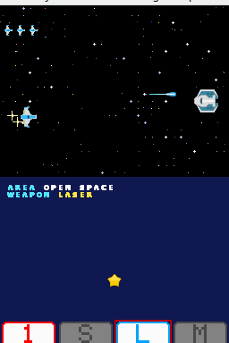
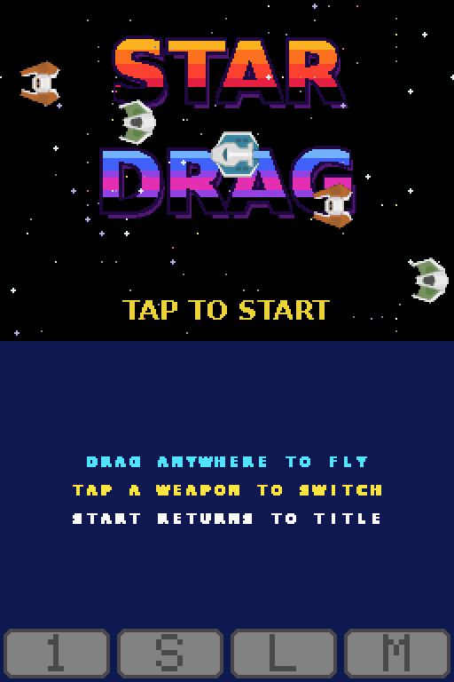
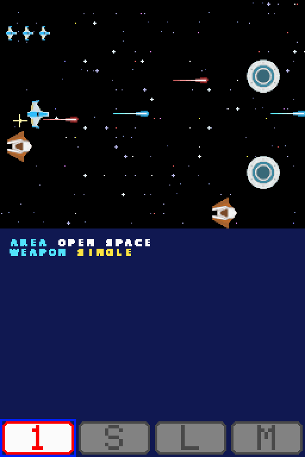
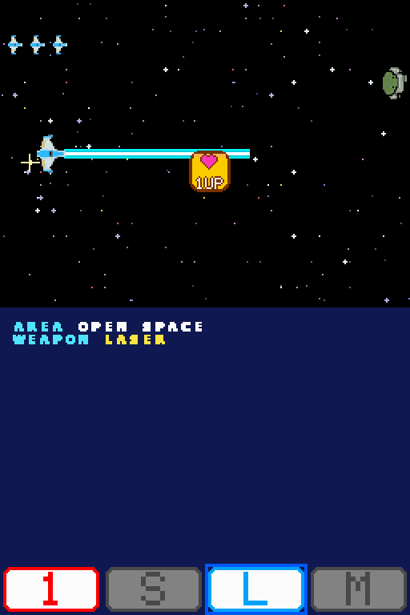
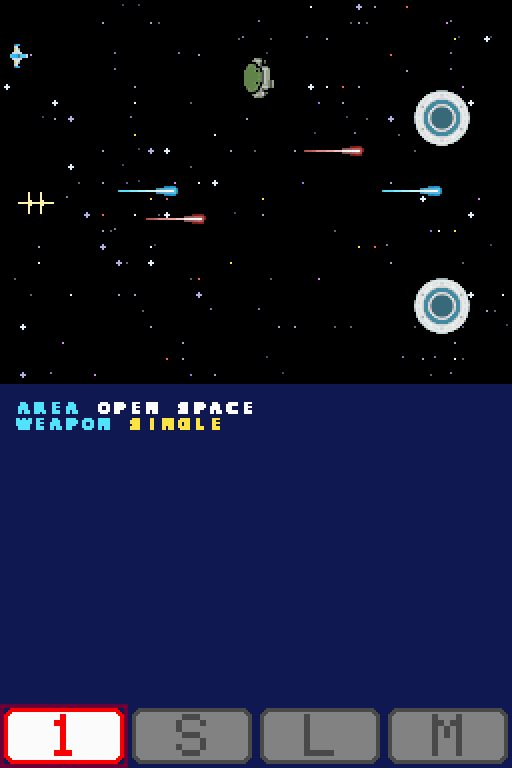

# Star Drag

A touch-and-drag horizontal shoot-'em-up for the Nintendo DS — R-Type / Life Force style. Fly left-to-right through 7 areas, blast 40 enemy types, take down 4 bosses, and grab weapon capsules to upgrade your guns. Built with devkitARM / libnds, entered in the [DS Homebrew Jam 2026](https://itch.io/jam/ds-homebrew-jam-2026).

**Download the ROM:** [star-drag-v19.nds](https://github.com/retroromrunner/star-drag/releases/tag/v1.0) (also on [itch.io](https://retroromrunner.itch.io/star-drag))




## How to play

**Best on NooDS** (including NooDS on iOS) — the game runs there exactly as designed.

**melonDS:** turn the JIT recompiler **OFF** (Settings → Emu → JIT recompiler) before loading the ROM. With JIT on, melonDS shows a blank white screen for this ROM — and for other homebrew built with the same toolchain — while retail games boot fine. This is a melonDS/JIT quirk, not a broken ROM: the same build renders correctly in NooDS and in melonDS with JIT off. See `qa/MELONDS-INVESTIGATION.md` for the full investigation.

DeSmuME is not recommended for this ROM.

## Controls

| Input | Action |
| --- | --- |
| Stylus drag (bottom screen, above the panel) | Fly the ship (1:1 with the drag) |
| Stylus tap on a weapon button | Switch weapon (only weapons you have collected) |
| Stylus tap elsewhere | Nothing — a tap never moves the ship |
| D-pad | Fly the ship (fallback) |
| Touch / START on title | Start |
| Touch / START on game over | Fly again |

Auto-fire is always on.

## The game

- **Top screen:** the playfield — 3-layer parallax starfield, your ship, alien waves, bullets, explosions, score / lives / wave HUD and the boss HP bar.
- **Bottom screen:** touch control only — the area name, the selected weapon, and the weapon panel.
- **Weapons:** start with SINGLE shot. Capsules dropped by enemies grant SPREAD (3-way fan), LASER (long piercing beam) or MISSILES (rockets with spark trails). A separate red-bolt capsule raises fire rate in steps. Getting hit drops you back to SINGLE.
- **Enemies:** 40 types across 7 areas — OPEN SPACE, SPACE BASE, PLANET, CAVE, CRYSTAL, WATER, GOO — each with its own ceiling/floor palette, terrain obstacles, movement pattern and pixelated explosion. Waves escalate with kills: faster spawns, faster enemies, more types.
- **Bosses:** every 3rd wave. Boss 1 reverses the scroll, boss 2 halts the world, boss 3 flies the world upward, boss 4 shields and charges. No other enemies appear during a boss fight — you fight the boss alone. Each boss has its own 64×64 sprite and multi-explosion death sequence.
- **Sound:** one unique music track per area (7 tracks, embedded in the ROM), tempo lifting 25% during boss fights, plus synthesized shoot / explosion / alarm / pickup SFX.

## Screenshots

| | |
| --- | --- |
|  |  |
|  |  |

## Build

Requires the devkitARM toolchain (devkitARM gcc 16.1.0, libnds 2.0.2, calico 1.2.0, ndstool 2.3.1):

```sh
./build.sh        # builds star-drag.nds
```

`build.sh` also fixes the ROM header to plain DS (the calico ARM7 writes a DSi-enhanced header, which melonDS/DeSmuME reject) and pads the ROM to its declared 4 MB capacity. See `qa/MELONDS-INVESTIGATION.md` and the header notes in `README` history (`qa/CHANGELOG.md`) for details.

## Credits

- **Designer** — design, code, music direction
- Sprites: **Kenney Space Shooter Redux** — CC0 1.0, by Kenney (https://kenney.nl)
- Extra enemy sprites: **opengameart.org** — "alienSpriteSheet" by rrodi411 (CC0); "Jellyfish" by StendhalGame (CC-BY-SA 4.0); "32x32 Worms Pack" (CC-BY-SA 4.0); "Green Robot Enemy" (CC0); "creepy-thing" (CC0). Full per-sprite credits in `qa/CHANGELOG.md`.
- Music: original synthwave chiptune tracks generated with Speechma.

## License

Code is provided as-is for learning and remixing; art and music carry the licenses of their sources above (CC0 / CC-BY-SA 4.0 as noted).
